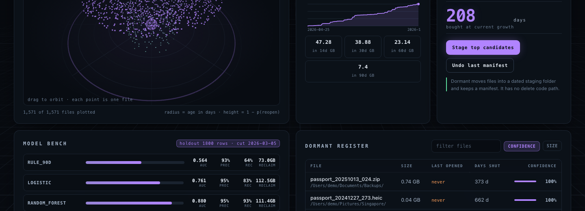
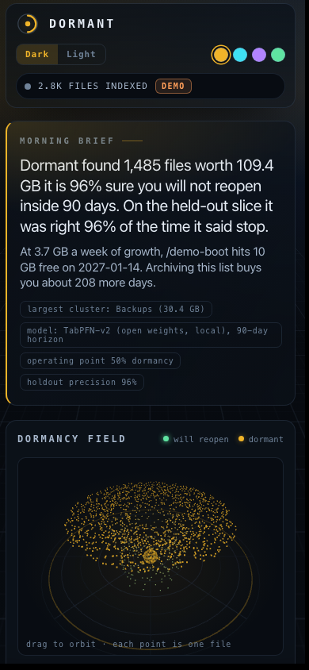

# Dormant

**An open-weight model that reads what macOS already recorded about your files and tells you which of them you are never going to open again.**


Dormant answers one question about a file that has already been shut for three weeks: *does it come back inside ninety days?* The answer decides whether 71 GB of your disk is a library or a landfill.

It runs on an 8 GB Apple M1, on CPU, with no network access, no API key, no account and no bill. The model is [TabPFN](https://github.com/PriorLabs/TabPFN), an open-weight tabular foundation model, and the entire checkpoint is 28 MB.

```
Dormant found 519 files worth 71.0 GB it is 99% sure you will not reopen inside 90 days.
On the held-out slice it was right 99% of the time it said stop.
```

---

## Why the labels are real

macOS keeps an open history per file. `mdls -name kMDItemUsedDates` returns every date a document app touched a file, and `kMDItemLastUsedDate` returns the most recent one. That is a labelled dataset that already exists on your machine, collected without you doing anything.

So Dormant does not watch for a month hoping to learn. It reads three years of history on the first run, and then it accumulates.

For a file created at `C` with recorded opens `d1..dk`, Dormant builds one observation row per sampled point inside each dormancy streak:

| as-of `T` | features visible at `T` | label |
|---|---|---|
| `C`, `d1`, `d2` … | age, recency, open count, gap stats, size, extension, folder, weekday | `1` if an open falls in `(T, T+90d]` |
| same | same | `0` if the next open is more than 90 days later, or never comes |
| same | same | **dropped** if `T + 90d` is still in the future |

That last row is the whole difference between an evaluation and a fiction. A window that has not closed is censored, never guessed.

The split is on the observation date, never random. Two rows from the same file share a history, so a random split would put yesterday inside tomorrow. Validation is rolling-origin: train on all history up to a cut, score the slice immediately after it.

## What it measured

Real index, this machine: 88,250 files walked, 12,719 openable files stored, 669 personal documents, 283 of them carrying recorded open history, 6,918 labelable observation rows. Time-split holdout of 4,842 train and 1,800 test rows, cut 2025-03-01, 10.6% positive.

| model | AUC | precision | recall | GB reclaimed | wrong calls |
|---|---|---|---|---|---|
| rule: 90 days idle | 0.378 | 0.862 | 0.704 | 3.9 | 181 |
| logistic regression | 0.821 | 0.959 | 0.714 | 45.0 | 49 |
| random forest | 0.920 | 0.985 | 0.758 | 44.4 | 19 |
| **HistGradientBoosting** | **0.962** | 0.988 | 0.895 | **45.3** | 18 |
| TabPFN-2 (open weights, shipped) | 0.956 | 0.987 | 0.885 | 45.1 | 19 |

The first row is the finding. "Archive anything untouched for ninety days", which is what a person writes by hand in an afternoon, scores **worse than a coin flip**: ninety days idle is exactly what a file looks like in the week before a deadline drags it back. The model is not beating a strawman, it is beating the heuristic that motivated the product.

The second finding is less comfortable and is reported anyway. Dormant benchmarks itself as the labelled corpus shrinks, because a personal corpus is small and that is the regime an in-context model is supposed to own. On my machine a boosted-tree baseline wins at every size:

| labelled rows | TabPFN | hist gb | random forest | logistic |
|---|---|---|---|---|
| 120 | 0.934 | **0.936** | 0.883 | 0.654 |
| 240 | 0.944 | **0.961** | 0.906 | 0.716 |
| 480 | 0.943 | **0.952** | 0.885 | 0.935 |
| 960 | 0.943 | **0.956** | 0.885 | 0.775 |
| 1,920 | 0.947 | **0.953** | 0.902 | 0.801 |

So why ship TabPFN? Not for the last decimal. It is the default because it needs no training run, no feature engineering loop and no hyperparameter search, it fits in 444 MB of RAM, and changing the question from 30 days to 90 is a constant and a re-run rather than a re-fit. The scoreboard keeps the baselines in it precisely so that claim stays falsifiable, and this table is what happened when I tried to falsify it.

## Why open weights, specifically

- **There is no upload path.** Your Spotlight database is the training set. A closed API cannot accept it, not because of policy but because the thing it would need is a per-machine record of every file you have ever opened.
- **Per-user adaptation costs nothing.** The model is fitted to *this* machine's habits at each run. A hosted model would need your history on its server, and a fine-tuning run would need a GPU.
- **It fits the laptop that has to run it.** TabPFN-2's checkpoint is 28 MB and peaks at 444 MB of RAM. TabPFN-3.5 is recommended upstream and is wired in behind `DORMANT_TABPFN_MODEL=3.5-fast`, but its fast checkpoint is 334 MB and it sits behind a licence-acceptance wall that needs an account. A product about doing nothing should not require a signup.
- **Swapping it is a config change.** `dormant/model.py` treats the predictor as a provider. Baselines are in the same scoreboard precisely so the open-weight claim can be falsified.

## Three levels of letting go

Dormant can destroy a file, so the ladder to get there is deliberately uneven.

| action | what happens | reversible by |
|---|---|---|
| `archive` | moves into `~/Dormant Archive/<date>/`, writes a manifest | `undo`, from the index |
| `trash` | moves into the macOS Trash | Finder's Put Back, or `undo` |
| `purge` | `os.remove`, for real | nothing in this program |

`purge()` requires the caller to pass the exact string `DELETE`, writes the manifest of what is about to be lost **before** the first unlink, and `latest_manifest()` skips delete manifests so `undo` can never offer to reverse one. Everything else is shared: no path that is not in the index, no protected system prefix, no symlink, no overwriting (collisions become `file.dup1.ext`).

`archive` and `trash` are also tested against a tripwire: `os.remove`, `os.unlink`, `os.rmdir` and `os.replace` are patched to raise, so if either function ever learns to delete, the suite fails.

The dashboard exposes all three, with `Delete permanently` behind a typed phrase and `Preview` in front of all of them, because the fastest way to trust a list of 730 files is to look at six of them.

## What it will not do

- **It never overwrites.** A name collision produces `file.dup1.ext`, and a test asserts both files survive with their bytes intact.
- **It refuses what it does not know.** Paths that are not in the index, protected system prefixes, symlinks and already-moved files are skipped, not forced.
- **It does not let the model state numbers.** The brief is a template over computed integers. A language model that rounds 71.3 GB to "about 70" is a bug.
- **It does not serve your files to anything that asks.** The preview endpoints hand out real file contents, so they require a token that is generated at server start and injected into the page's HTML. A random process or website reaching `127.0.0.1:8712` gets 403, and there is a test for it.

## Install and run

```bash
python3 -m venv .venv && source .venv/bin/activate
pip install -r requirements.txt

python cli.py scan                 # index your files from stat + Spotlight
python cli.py brief                # the two-line morning brief
python cli.py top --limit 20       # what it thinks is dead
python cli.py bench                # the scoreboard above, on your machine
python cli.py run --bench          # scan, bench, score, brief
python cli.py serve                # mission control on http://127.0.0.1:8712

python cli.py --demo demo          # synthetic corpus: safe to screenshot
python cli.py --demo run --bench
python cli.py --demo serve

python cli.py preview 12 41 7      # Quick Look indexed files
python cli.py archive --top 50 --max-gb 10      # previews without --yes
python cli.py undo --yes
python cli.py trash --top 20 --yes              # to the macOS Trash
python cli.py purge --ids 12 41 --phrase DELETE --yes   # irreversible

python -m pytest -q                # 43 tests
```

`scan` roots default to `~/Downloads ~/Desktop ~/Documents`; pass `--roots` for anything else. The nightly job is whatever scheduler you like:

```bash
cd /path/to/Dormant && .venv/bin/python cli.py scan && .venv/bin/python cli.py brief
```

## The dashboard


Radius is age, height is `1 - p(reopen)`, so the silhouette of a neglected disk is legible before you read a number. The corpus shown here is the **synthetic** one.



One page of vanilla JS with three.js **vendored in `web/vendor/`**, so the console renders with the network off. Dark and light themes, four accents, a density toggle, `?theme=&accent=` for shareable state, reduced-motion support, and a mobile layout that becomes tabs rather than a shrunk desktop.




`web/snapshot.json` is a capture of the **synthetic** corpus so the page can be shown with no backend at all.

## Honest limitations

- Only about a third of personal documents carry recorded open history. The rest are scored from age, size, type and folder, and Dormant gets better as its nightly snapshots accumulate. That is why the product is named after an animal that is in no hurry.
- The disk-fill projection needs two distinct days of snapshots. On a first run it reports "no measurable fill rate" instead of inventing a date. The reconstructed creation curve is a **floor**, because deletions are invisible to it.
- macOS only. The label source is Spotlight.
- TabPFN-2 weights are non-commercial licensed, which suits a hackathon and does not suit a product. The code, the engine and the dashboard are GPL-3.0.
- HistGradientBoosting edges TabPFN on AUC on this corpus (0.967 vs 0.955). It does so after a training run on a machine with 8 GB of RAM, and it would not be worth a paragraph of this README on a corpus of 120 rows.

## Hacktoberfest

Submission for the [Hacktoberfest Open-Source AI Challenge, Week 3: Slow and Steady](https://dev.to/challenges/hacktoberfest-week3-2026-10-19). Entered in **Best Use of TabPFN**.

## Licence

GPL-3.0-or-later for the code. Model weights are governed by their own upstream licence.
